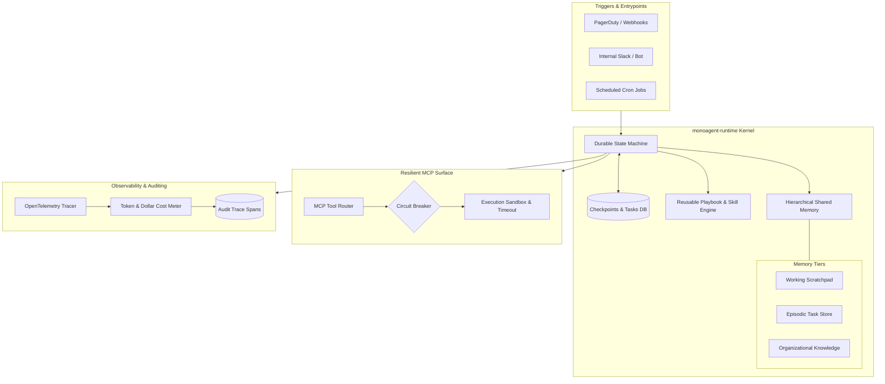

# `monoagent-runtime`

[](https://github.com/driasim/monoagent-runtime/actions)
[](https://www.python.org/downloads/)
[](https://opensource.org/licenses/MIT)

> **Enterprise Monoagent Kernel for Long-Running Tasks, Shared Memory, MCP Tooling, and Telemetry.**

Most agent prototypes are ephemeral chat bots that forget state after one HTTP round-trip. In production, enterprise agents need to:
1. **Outlive a single request:** Run asynchronous, long-running background tasks with durable checkpointing and failure recovery.
2. **Access Shared Company Memory:** Connect working scratchpads, past episodic task solutions, and organizational SOPs.
3. **Safeguard MCP Tool Surfaces:** Route tool calls through execution sandboxes, schema validation, and **circuit breakers** that stop runaway loops before costs explode.
4. **Deliver Financial & Operational Observability:** Track per-step prompt/completion tokens, latency profiling, and real-time dollar cost attribution per tenant.

---

## 🏛️ System Architecture



---

## 🚀 Key Capabilities

### 1. Durable Long-Running Execution & Checkpointing
Tasks transition through explicit lifecycle states (`QUEUED` → `RUNNING` → `WAITING_FOR_TOOL` → `COMPLETED`/`FAILED`). Every turn automatically snapshots scratchpad context and conversation history to durable storage, allowing agents to survive process crashes, restart, and resume work safely.

### 2. Resilient MCP Tool Router with Circuit Breakers
Prevents the catastrophic **runaway retry loop** where an agent repeatedly calls an unhealthy or rate-limited internal tool. If an MCP tool fails or returns empty payloads 3 consecutive times, the circuit breaker trips, cutting off execution and alerting operators instead of burning API budget.

### 3. Hierarchical Shared Memory
* **Working Scratchpad:** Fast in-memory state during an active multi-turn run.
* **Episodic Memory:** Cross-task index of past agent resolutions across the team.
* **Organizational Knowledge:** Company SOPs, access policies, and infrastructure documentation.

### 4. OpenTelemetry Tracing & Dollar Cost Metering
Every agent step emits trace spans recording model name, prompt tokens, completion tokens, tool execution latencies, and dollar cost based on model pricing tariffs.

---

## 💻 Quickstart

### Installation

```bash
git clone https://github.com/driasim/monoagent-runtime.git
cd monoagent-runtime
pip install -e .
```

### Run the Incident Remediation Demo

```bash
python examples/run_monoagent.py
```

### Run Tests

```bash
pytest -v tests/
```

---

## 📖 Code Example: Running a Monoagent Step

```python
import asyncio
from monoagent.core.kernel import MonoagentKernel
from monoagent.core.task import LongRunningTask
from monoagent.memory.shared_memory import HierarchicalMemory
from monoagent.mcp.router import MCPToolRouter
from monoagent.telemetry.tracer import AgentTelemetryTracer

# 1. Initialize shared memory & MCP router
memory = HierarchicalMemory(tenant_id="infra-team")
router = MCPToolRouter(failure_threshold=3)

# 2. Register tools with schema validation
router.register_tool(
    name="restart_service",
    description="Restarts a Kubernetes deployment pod safely",
    handler=my_k8s_restart_fn,
    parameters_schema={"type": "object", "properties": {"service": {"type": "string"}}},
)

# 3. Create kernel & long-running task
kernel = MonoagentKernel(tenant_id="infra-team", memory=memory, tool_router=router)
task = LongRunningTask(task_id="task-902", title="Service Remediation", initiator_id="alice", tenant_id="infra-team")
tracer = AgentTelemetryTracer(task_id=task.task_id, tenant_id=task.tenant_id, user_id="alice", model="gpt-4o")

# 4. Execute step with durable checkpointing & telemetry
async def run():
    result = await kernel.execute_task_step(task, "restart payment-api service", tracer, my_step_handler)
    print(f"Task status: {result['task_state']}, Step checkpointed.")

asyncio.run(run())
```

---

## 🛡️ Production War Stories & Architecture Insights

1. **Why internal assistants get abandoned:**
   Most companies deploy chat interfaces (e.g. Slack bots) and wonder why engineers stop using them. Real adoption happens when agents are **invisible, headless, and tied to existing workflows** (e.g. triggered on GitHub PRs, alerting webhooks, or scheduled syncs) rather than asking users to prompt-engineer blank chat boxes.
2. **Preventing context pollution in long-running jobs:**
   Agents executing 20+ steps inevitably drown in their own context window. `monoagent-runtime` uses durable checkpointing and scratchpads to prune intermediate noise, retaining only crisp state deltas between execution phases.

---

## 📄 License
MIT © Ibrahim Aliyu Saddique (`@driasim`)
